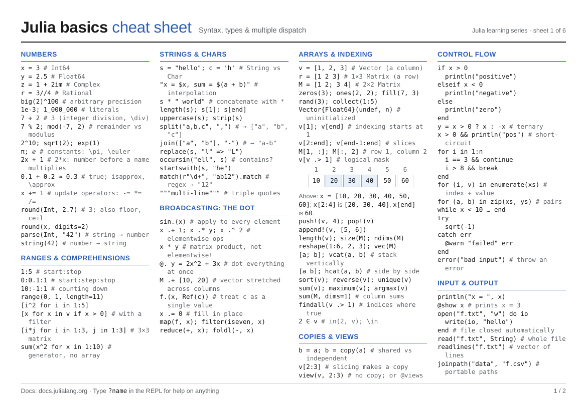
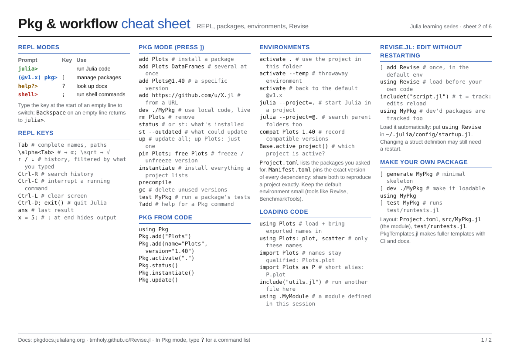
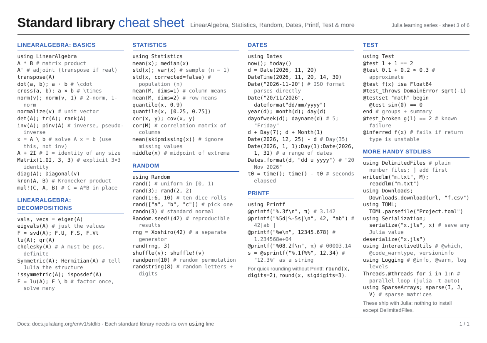
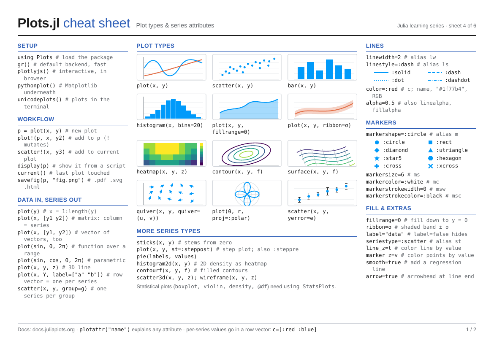
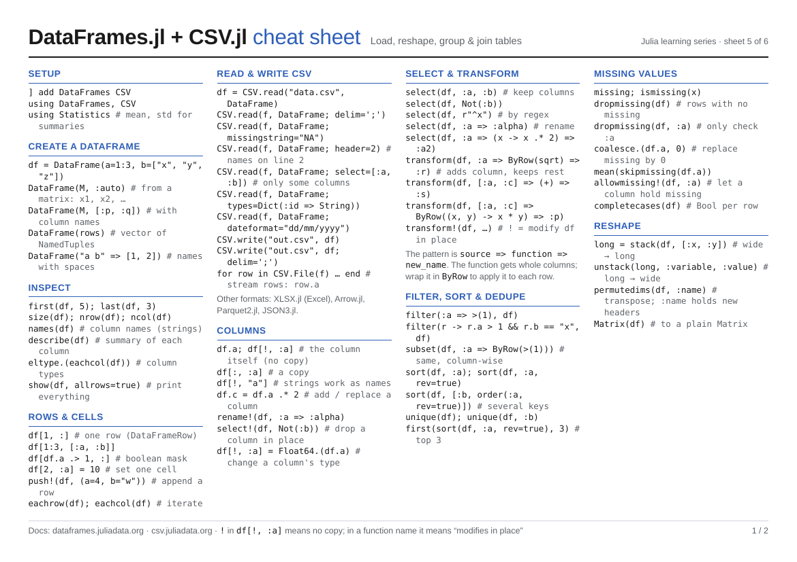
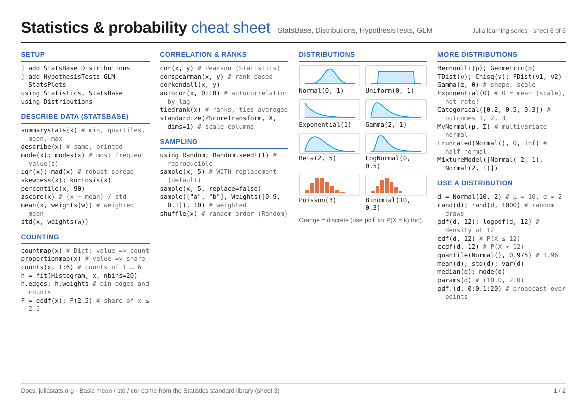

# Julia cheat sheets

A six-part series of printable cheat sheets for the Julia language and its most common packages.
Click a preview to open the PDF.

📥 **[Download all six sheets as one PDF](julia-cheatsheets-all.pdf)**

<table>
  <tr>
    <td width="50%" align="center" valign="top">
       
      <a href="julia-1-basics-cheatsheet.pdf"><b>1 · Julia Basics</b></a> 
      Syntax, types & multiple dispatch
    </td>
    <td width="50%" align="center" valign="top">
       
      <a href="julia-2-pkg-workflow-cheatsheet.pdf"><b>2 · Pkg & Workflow</b></a> 
      REPL, packages, environments, Revise
    </td>
  </tr>
  <tr>
    <td width="50%" align="center" valign="top">
       
      <a href="julia-3-stdlib-cheatsheet.pdf"><b>3 · Standard Library</b></a> 
      LinearAlgebra, Statistics, Random, Dates, Printf, Test & more
    </td>
    <td width="50%" align="center" valign="top">
       
      <a href="julia-4-plots-cheatsheet.pdf"><b>4 · Plots.jl</b></a> 
      Plot types & series attributes · <a href="https://docs.juliaplots.org/stable/">docs</a>
    </td>
  </tr>
  <tr>
    <td width="50%" align="center" valign="top">
       
      <a href="julia-5-dataframes-csv-cheatsheet.pdf"><b>5 · DataFrames.jl + CSV.jl</b></a> 
      Load, reshape, group & join tables
    </td>
    <td width="50%" align="center" valign="top">
       
      <a href="julia-6-statistics-cheatsheet.pdf"><b>6 · Statistics & Probability</b></a> 
      StatsBase, Distributions, HypothesisTests, GLM
    </td>
  </tr>
</table>

Made with Claude Opus 5.5.
